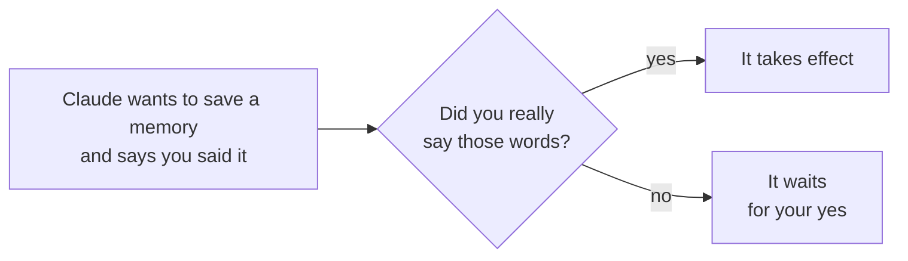
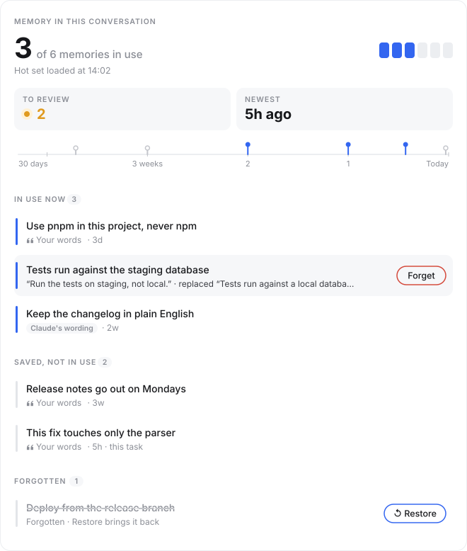
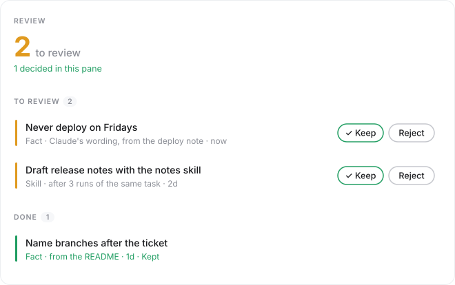

# AgentRoot for Claude Code

**English** | [简体中文](./README.zh-CN.md)

**In one line: Claude remembers what you told it, and only counts the words you really said as yours.**


## The idea in 30 seconds

Think of Claude as a very capable colleague who forgets everything each time you start a new conversation.

AgentRoot gives that colleague a **notebook** for the rules of your project, one sentence each. For example: "Use pnpm in this project, never npm."

A notebook alone leaves three problems. This plugin fixes them:

| The problem | What the plugin does |
|---|---|
| 😶 **The colleague often forgets to open the notebook.** | At the right moments, the plugin opens it and puts the few notes that matter for your message in front of Claude. |
| 🤥 **The colleague might write down something you never said, and claim you said it.** | The plugin checks the quote. If you really said it, it is saved as your words. If not, it waits for your yes. |
| 🙈 **You cannot see what is in the notebook.** | A band above the prompt shows it. One click shows every memory, and you can cross out a wrong one. |

## What you need to do: almost nothing

| When | What you do |
|---|---|
| Normally | Talk to Claude as usual. The plugin runs by itself. |
| The band shows `2 to review` | Click `Review`, then `✓ Keep` or `Reject` on each item. |
| You want to know what Claude remembers | Click `Memory`. |
| A memory is wrong | Point at it and click `Forget`. Nothing is deleted: `↺ Restore` brings it back until you close the pane. |

When you change something in a pane, the plugin tells Claude with your next message, so it stops using what you crossed out.

## Install (about 5 minutes)

You need:

- **Claude Code** ([how to get it](https://code.claude.com/docs))
- **Python 3.11 or newer** with PyYAML. Check the version with `python3 --version`; install PyYAML with `python3 -m pip install pyyaml`
- **macOS or Linux** (Windows is not tested)

Then type these in Claude Code:

1. Add the marketplace (a list of plugins):
   ```text
   /plugin marketplace add jesselei1102-hue/agentroot-claude-mod
   ```
2. Install the plugin. When asked for a scope, choose the smallest one (project or local), so the plugin works only in this project:
   ```text
   /plugin install agentzero@agentzero
   ```
   The plugin keeps its name from before the rename, `agentzero`, so an existing install needs no change.
3. Open your project folder and set up the notebook there:
   ```text
   /agentroot init
   ```
4. **Start a new conversation in the same folder.** Claude Code reads these files only when a conversation starts.
5. To check the setup, type `/agentroot status`.

## An example

```text
You:      Use pnpm in this project, never npm. npm breaks our lockfile.

Claude:   (saves "Use pnpm, never npm", quoting your words)
Plugin:   ✓ You really said that. It takes effect now.
          Next week, in a new conversation, Claude still uses pnpm.

Later, Claude reads a deploy note and wants to save "Never deploy on Fridays", claiming you said it.

Plugin:   ✗ You never said that. It may not pass as your words; it waits for your yes.
Claude:   I found a rule in the deploy note: never deploy on Fridays. Do you want me to keep it?
```

Without the plugin, Claude would follow a rule that you never gave.



Even with a real quote, AgentRoot also holds a memory for your yes when Claude's sentence says more than your words did.

## What the words on screen mean

| You see | It means |
|---|---|
| `Using 3 of 6 memories` | You have 6 memories saved; in this conversation Claude uses the 3 that matter most for what you are doing. |
| `2 to review` | 2 items wait for your yes. Hidden when nothing waits. |
| `context 34%` | 34% of this conversation's space is used. When it is nearly full, Claude Code compacts the conversation, and the plugin hands Claude the memories again afterwards. |
| Red `hot set not loaded (…)` | This time the memories did not reach Claude; the reason is in brackets. Your message is still sent. |
| `In use now` / `Saved, not in use` / `Forgotten` | Used in this conversation / saved but not used now / crossed out |
| `Your words` | Your own words back this memory up. |
| `Claude's wording` | Claude wrote it, and you kept it. |
| `this task` · `Updated` | Holds only for the current task · replaced an older memory |

**The Memory pane** (click `Memory`): the figures at the top, then one line per memory. Point at a line to see your words and `Forget`.



**The Review pane** (click `Review`): every item has `✓ Keep` and `Reject`.



When Claude writes to the memory, a small card also shows in the chat: green when a memory is saved with your words, amber when it waits for your yes, blue when Claude uses a saved procedure (a Skill).

## When the plugin hands Claude the memories

- on the first message of a conversation;
- on the first message after `/compact` (shortens the conversation) or `/clear` (starts over);
- on the first message after six hours.

It takes about 0.1 seconds, and you do not see it. If it fails or takes more than 10 seconds, your message is sent anyway and the band says why.

## Commands

| Command | What it does |
|---|---|
| `/agentroot init` | Sets up the notebook in the current folder. It refuses your home folder, the root folder `/`, and a folder that already has one. |
| `/agentroot status` | Checks that everything can run, and shows the versions. |
| `/agentroot review` | Opens the Review pane. |
| `/agentroot memory` | Opens the Memory pane. |
| `/agentroot upgrade` | Updates the notebook to the AgentRoot version in this plugin. It does not overwrite files you changed. |

`/agentzero`, the old name, still works and does the same.

## Limits

- **Claude Code only.** Codex and Cursor do not use this plugin.
- **A shortened quote passes the check.** The check proves that the words are yours, not that they are all of your words.
- **Not tested yet:** Windows. Terminal and VS Code (the desktop app is tested). A first install on a computer that never had AgentRoot.
- **In the desktop app, the cards do not always show**: the app folds a run of commands into one line. The band and the panes show the same information.
- **The plugin uses an early-access Claude Code feature** (function hooks), which can change in later Claude Code versions.

<details>
<summary>More technical detail</summary>

- **The plugin reads one form of the save command:** an optional `cd <folder> &&`, then `./a0 memory remember ...` (or `python -m memory remember ...`). The values must be plain text in quotes, and the only options it reads are `--said`, `--fact-key`, `--scope`, `--tag` and `--source-run`. Any other form runs as written, and you see: `the operator's words in this remember were not checked`.
- **A repeated task is found only if it calls an MCP tool.** A **Skill** is a saved procedure for one kind of task; an **MCP tool** is a tool from a server you connect to Claude Code. AgentRoot finds a task that came back by comparing the MCP tools each run called, so a task done only with files and the shell never looks repeated. The assistant does offer a Skill in two cases (tested): when you say a task is to be done this way every time, and after it writes a script that turns a batch of files into what you asked for.
- **The desktop app shows the status line small**, next to the model name, so every plugin message also shows as a short pop-up (a toast).
- **Tested on** Claude Code 2.1.280 and 2.1.289 (terminal) and 2.1.286 (desktop app).
- **Words in the docs:** a **Fact** is what the screen calls a memory; **active** means in effect, **proposed** means waiting for your yes; the **hot set** is the few most relevant memories handed to Claude each time.

</details>

## For developers

How the repository is organised:

```text
.claude-plugin/marketplace.json   the marketplace (one plugin)
plugins/agentzero/
  hooks/                          the plugin code (TypeScript) and its tests
  tools/snapshot.py               prints the memory state as JSON for the band, the pane and the cards
  kernel/                         a pinned copy of AgentRoot (Python)
                                  SOURCE.json: its commit and the hash of each file
scripts/sync_kernel.py            copies one AgentRoot commit into kernel/
scripts/render_hud.ts             draws the HUD figures in docs/hud/ with the plugin's own drawing code (bun scripts/render_hud.ts)
tests/                            Python tests: the copy script, and kernel/ against SOURCE.json
docs/                             the designs (spec.md, hud-spec.md), what was tested (verify.md), and how to write tests (test-kit.md)
```

The plugin does not rewrite AgentRoot. It runs the copy in `kernel/`. A test compares each file in `kernel/` with its hash. So the copy is exactly AgentRoot. The plugin code is about 1,500 lines.

To try a change in the desktop app: commit it, raise `version` in `plugins/agentzero/.claude-plugin/plugin.json`, run `claude plugin update agentzero@agentzero --scope local` in the project where the plugin is installed, then quit and reopen the app. The desktop app runs the copy that the update command makes. The terminal reads the folder directly.

Run the tests:

```bash
claude plugin test plugins/agentzero    # the plugin code
python3 -m pytest                       # the copy script and kernel/
```

To use a new AgentRoot version:

```bash
python3 scripts/sync_kernel.py <path to AgentRoot> --ref <tag> --denylist <file>
```

Then release a new plugin version. See [CHANGELOG.md](./CHANGELOG.md) and [DECISIONS.md](./DECISIONS.md).

## License

MIT. `kernel/LICENSE` is the license of AgentRoot.
