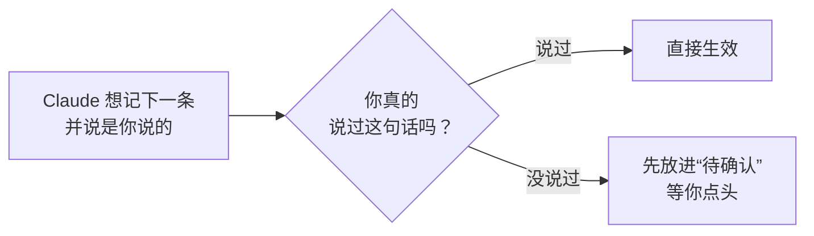

# AgentRoot for Claude Code

[English](./README.md) | **简体中文**

**一句话：让 Claude 记住你说过的话，而且只把你真说过的话当成你的话。**


## 30 秒看懂

把 Claude 想成一位很能干、但每开一次新对话就失忆的同事。

**[AgentRoot]**给这位同事一本**笔记本**，记下你项目里的规矩，一条一句话。比如：“这个项目用 pnpm，不要用 npm。”

笔记本有了，还剩两个麻烦。这个插件把它们补上：

| 麻烦 | 插件怎么办 |
|---|---|
| 😶 **他常常忘了翻笔记本。** | 每到关键时刻，插件替他翻开，把和你这句话最相关的几条放到他面前。 |
| 🤥 **他可能往本子里写你没说过的话，还说是你说的。** | 插件核对原话：你真说过，才记成“你的话”；没说过，就先放进“待你确认”。 |
| 🙈 **你看不见本子里写了什么。** | 输入框上方有一条提示条，点一下就能看全部记忆，记错的随手划掉。 |

## 你要做什么？几乎什么都不用做

| 什么时候 | 你做什么 |
|---|---|
| 平常 | 照常和 Claude 说话。插件自己运行。 |
| 提示条上出现 `2 to review` | 点 `Review`，每条点 `✓ Keep`（保留）或 `Reject`（不要）。 |
| 想知道 Claude 记得什么 | 点 `Memory`。 |
| 发现一条记错了 | 鼠标指向它，点 `Forget`。不会真的删掉，面板关掉之前点 `↺ Restore` 就能找回来。 |

你在面板里做的改动，插件会在你下一条消息时告诉 Claude，它不会再用你划掉的那条。

## 安装（约 5 分钟）

先准备好：

- **Claude Code**（[获取方法](https://code.claude.com/docs)）
- **Python 3.11 或更高版本**，装好 PyYAML。查版本：`python3 --version`；装 PyYAML：`python3 -m pip install pyyaml`
- **macOS 或 Linux**（Windows 还没测试过）

然后在 Claude Code 里依次输入：

1. 添加插件市场（就是一份插件列表）：
   ```text
   /plugin marketplace add jesselei1102-hue/agentzero-claude-mod
   ```
2. 安装插件。问你范围时，选最小的（project 或 local），插件就只在这个项目里工作：
   ```text
   /plugin install agentzero@agentzero
   ```
   插件的名字还是改名前的 `agentzero`，所以以前装过的人什么都不用改。
3. 打开你的项目文件夹，在这里建好笔记本：
   ```text
   /agentroot init
   ```
4. **在同一个文件夹里开一个新对话。** Claude Code 只在对话开始时读取这些文件。
5. 想确认装好了，输入 `/agentroot status`。

## 看一个例子

```text
你：      这个项目用 pnpm，不要用 npm。npm 会破坏我们的锁文件。

Claude：  （记下“用 pnpm，不用 npm”，并引用你的原话）
插件：    ✓ 这句话你确实说过。直接生效。
          下周开新对话，Claude 仍然会用 pnpm。

后来，Claude 读到一份部署说明，想记下“周五不部署”，还说这是你说的。

插件：    ✗ 你从没说过这句话。不让它冒充你的话，改成“待确认”。
Claude：  我在部署说明里看到一条规则：周五不部署。要我保留它吗？
```

没有这个插件，Claude 会把一条你从没定过的规则当成你的要求来遵守。



另外，就算引用是真的，只要 Claude 写下的比你的原话说得更多，AgentRoot 也会先放进“待确认”。

## 屏幕上的字是什么意思

界面上的字是英文。对照表：

| 你看到的 | 意思 |
|---|---|
| `Using 3 of 6 memories` | 你一共存了 6 条记忆，这次对话里 Claude 正在用和当前话题最相关的 3 条。 |
| `2 to review` | 有 2 条等你点头。没有待确认的时候不显示。 |
| `context 34%` | 这次对话的容量用了 34%。快满时 Claude Code 会压缩对话，压缩之后插件会把记忆重新递给 Claude。 |
| 红色的 `hot set not loaded (…)` | 这一次没能把记忆递给 Claude，括号里写着原因。你的消息照常发出。 |
| `In use now` / `Saved, not in use` / `Forgotten` | 正在用 / 存着但这次没用 / 已划掉 |
| `Your words` | 这条有你的原话为证。 |
| `Claude's wording` | 这条是 Claude 写的，你确认后保留了。 |
| `this task` · `Updated` | 只对当前这个任务有效 · 这条替换了旧的一条 |

**记忆面板**（点 `Memory`）：顶部是数字，下面每条记忆一行。鼠标指向一行，能看到你的原话和 `Forget`。


**待确认面板**（点 `Review`）：每条都有 `✓ Keep` 和 `Reject`。


Claude 写入记忆时，聊天里还会出现一张小卡片：绿色是用你的原话记下了，黄色是在等你确认，蓝色是 Claude 用了一个保存好的做法（Skill）。

## 插件什么时候把记忆递给 Claude

- 每个对话的第一条消息；
- `/compact`（压缩对话）或 `/clear`（清空重来）之后的第一条消息；
- 隔了六小时之后的第一条消息。

这一步约 0.1 秒，你看不到它。如果失败或超过 10 秒，消息照常发出，提示条会写明原因。

## 命令

| 命令 | 作用 |
|---|---|
| `/agentroot init` | 在当前文件夹建好笔记本。不会在你的主目录、根目录 `/`，或已有笔记本的文件夹里建。 |
| `/agentroot status` | 检查能不能正常运行，显示版本。 |
| `/agentroot review` | 打开待确认面板。 |
| `/agentroot memory` | 打开记忆面板。 |
| `/agentroot upgrade` | 把笔记本更新到插件自带的 AgentRoot 版本。你改过的文件不会被覆盖。 |

旧名字 `/agentzero` 仍然可用，作用相同。

## 目前的限制

- **只支持 Claude Code**，Codex 和 Cursor 用不了。
- **截短的引用也能通过检查。** 检查只能证明这些话是你说的，不能证明是你说的全部。
- **还没测试：** Windows；终端和 VS Code（桌面 app 已测试）；在从没用过 AgentRoot 的电脑上第一次安装。
- **在桌面 app 里，小卡片不一定看得到**：app 会把连续的命令折叠成一行。提示条和面板显示的是同样的信息。
- **插件用了 Claude Code 的一个抢先体验功能**（function hooks），以后的 Claude Code 版本可能会变。

<details>
<summary>更多技术细节</summary>

- **插件只认一种写法的保存命令：** 可选的 `cd <文件夹> &&`，然后是 `./a0 memory remember ...`（或 `python -m memory remember ...`）。值必须是带引号的普通文字，只读 `--said`、`--fact-key`、`--scope`、`--tag`、`--source-run` 这几个选项。其他写法照原样运行，你会看到：`the operator's words in this remember were not checked`（这条 remember 里的话没有核对）。
- **只有调用了 MCP 工具的任务，才会被发现是重复的。** **Skill** 是为一类任务保存下来的做法；**MCP 工具**是你接入 Claude Code 的服务器提供的工具。AgentRoot 靠比较每次运行用了哪些 MCP 工具来发现重复的任务。只用文件和命令行的任务永远不会被看成重复。助手在两种情况下仍会提议做成 Skill（已测试）：你说一类任务以后每次都这样做；它写了一个脚本，把一批文件变成你要的结果。
- **桌面 app 的状态栏很小**，在模型名旁边，所以插件的每条消息也会以短暂弹出的提示（toast）显示。
- **测试过的版本：** Claude Code 2.1.280、2.1.289（终端）和 2.1.286（桌面 app）。
- **名词对照：** 文档里的 **Fact** 就是界面上的 memory（记忆）；**active** 是已生效，**proposed** 是待确认；**hot set** 是每次递给 Claude 的那几条最相关的记忆。

</details>

## 给开发者

仓库的结构：

```text
.claude-plugin/marketplace.json   插件市场（一个插件）
plugins/agentzero/
  hooks/                          插件代码（TypeScript）和它的测试
  tools/snapshot.py               把记忆状态输出成 JSON，供提示条、面板和卡片使用
  kernel/                         固定版本的 AgentRoot 副本（Python）
                                  SOURCE.json：它的提交号和每个文件的哈希
scripts/sync_kernel.py            把 AgentRoot 的某一个提交复制到 kernel/
scripts/render_hud.ts             用插件自己的绘图代码画出 docs/hud/ 里的 HUD 图（bun scripts/render_hud.ts）
tests/                            Python 测试：复制脚本，以及 kernel/ 对照 SOURCE.json
docs/                             设计（spec.md、hud-spec.md）、测试了什么（verify.md）、怎么写测试（test-kit.md）
```

插件没有重写 AgentRoot。它运行 `kernel/` 里的那份副本。有一个测试会把 `kernel/` 里每个文件和它的哈希比较。所以这份副本和 AgentRoot 完全一样。插件代码约 1,500 行。

在桌面 app 里试改动：先提交，再把 `plugins/agentzero/.claude-plugin/plugin.json` 里的 `version` 调高，在装了插件的项目里运行 `claude plugin update agentzero@agentzero --scope local`，然后退出并重新打开 app。桌面 app 运行的是这条更新命令复制出的副本；终端直接读文件夹。

运行测试：

```bash
claude plugin test plugins/agentzero    # 插件代码
python3 -m pytest                       # 复制脚本和 kernel/
```

使用 AgentRoot 的新版本：

```bash
python3 scripts/sync_kernel.py <AgentRoot 的路径> --ref <标签> --denylist <文件>
```

然后发布新的插件版本。详见 [CHANGELOG.md](./CHANGELOG.md) 和 [DECISIONS.md](./DECISIONS.md)。

## 许可证

MIT。`kernel/LICENSE` 是 AgentRoot 的许可证。
